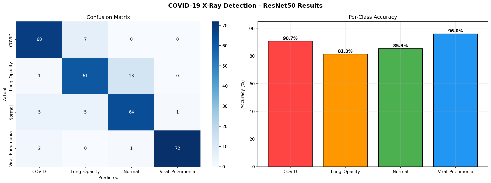
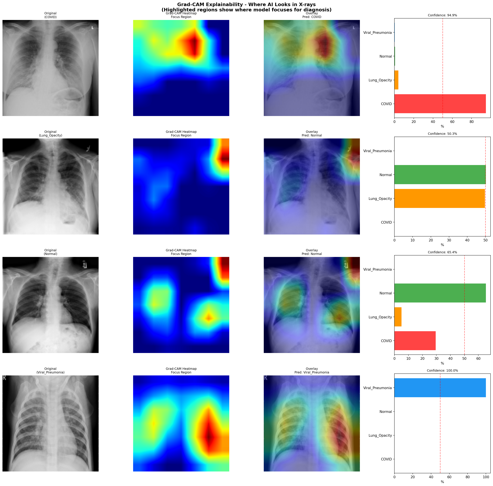
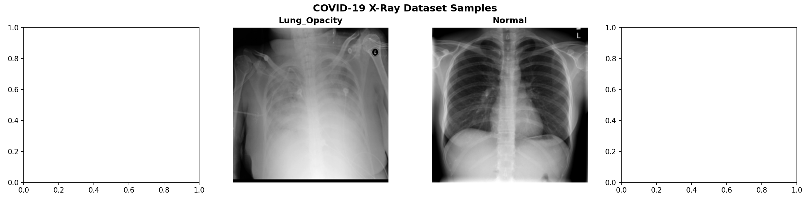

# covid-xray-detection
# COVID-19 X-Ray Detection with Explainable AI (Grad-CAM)

Deep learning system that detects COVID-19 from chest X-rays using ResNet50 transfer learning and Grad-CAM explainable AI.

## Results







## Performance Metrics

| Metric | Score |
|--------|-------|
| Test Accuracy | 88.33% |
| COVID Precision | 89% |
| COVID Recall | 91% |
| Viral Pneumonia Precision | 99% |
| Training Epochs | 15 |

## What is Grad-CAM?

Grad-CAM (Gradient-weighted Class Activation Mapping) is an Explainable AI technique that shows WHERE in the X-ray the model looks to make its diagnosis. This makes AI decisions transparent and trustworthy for medical use.

## Project Overview

- **Model:** ResNet50 (Transfer Learning from ImageNet)
- **Dataset:** COVID-19 Radiography Database (21,165 chest X-rays)
- **Classes:** COVID, Normal, Lung Opacity, Viral Pneumonia
- **XAI Method:** Grad-CAM visualization
- **Interface:** Gradio web app for real-time detection

## Dataset Distribution

| Class | Images |
|-------|--------|
| Normal | 10,192 |
| Lung Opacity | 6,012 |
| COVID | 3,616 |
| Viral Pneumonia | 1,345 |
| **Total** | **21,165** |

## Technologies Used

- Python 3.x
- PyTorch
- ResNet50 (Transfer Learning)
- Grad-CAM (Explainable AI)
- OpenCV
- Gradio
- Scikit-learn
- Matplotlib / Seaborn

## How to Run

```bash
pip install torch torchvision opencv-python matplotlib seaborn gradio scikit-learn
python main.py
```

Note: Download `best_model.pth` from Google Drive and place in same folder before running.

## Why This Matters

- COVID-19 early detection saves lives
- Explainable AI builds trust in medical AI systems
- Accessible tool for hospitals with limited resources
- Supports telemedicine and remote diagnostics

## Author

Dorathisha P — CSE Graduate | AI & ML Enthusiast | Erasmus Mundus Applicant 2027
